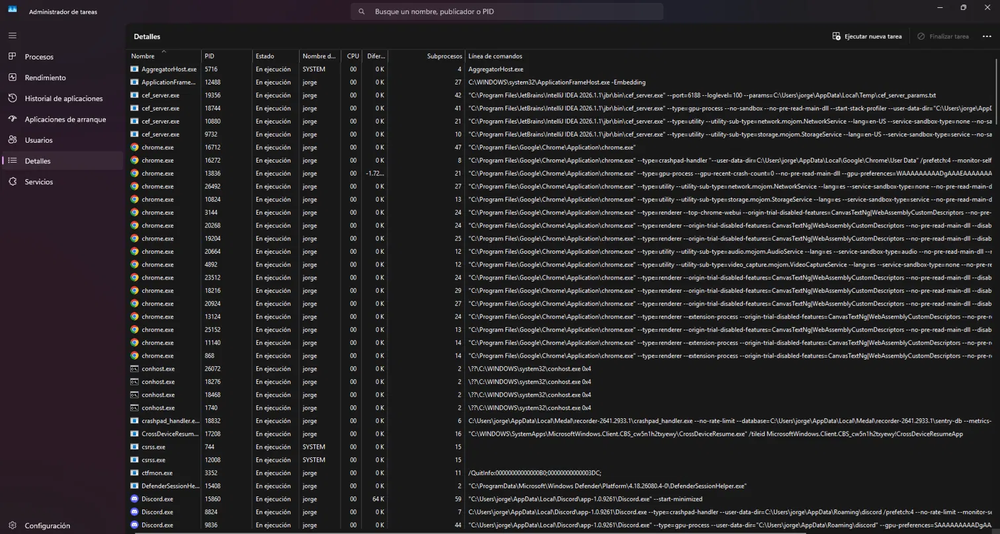

# Simulador de planificación · NexoData

> PSP · Tema 2 · Procesos · 2.º A DAM · **Jorge Moreno Rivero**

## 1. Qué hace

Es un programa de consola en Java que simula cómo un planificador de corto plazo reparte una sola CPU entre varios procesos. Lee los procesos de un fichero CSV (nombre, llegada y ráfaga) y los ejecuta con FCFS, SJF sin desalojo o Round Robin, según se le pida. Al terminar enseña el diagrama de Gantt, una tabla con fin, retorno, espera y respuesta de cada proceso con sus medias, los cambios de contexto y, si se pasa `--traza`, cada transición de estado con su motivo. Lo he usado para comparar los trabajos nocturnos de NexoData y recomendarles una política.

## 2. Cómo compilar y ejecutar

**Desde la terminal**, en la carpeta del proyecto:

```bash
javac -encoding UTF-8 -d out src/planificador/*.java
java -cp out planificador.Main datos/ejemplo_clase.csv rr 2 --traza
java -cp out planificador.Main datos/nocturno.csv todos 4
```

**Desde IntelliJ IDEA:** abrí la carpeta `planificador-nexodata` con *File → Open* y elegí una JDK (yo uso la 27; vale cualquiera desde la 17) en *File → Project Structure → Project*. Después creé una configuración de tipo *Application* en *Run → Edit Configurations*, con `planificador.Main` como clase principal. En *Program arguments* puse, por ejemplo, `datos/ejemplo_clase.csv rr 2 --traza`, y en *Working directory* la carpeta del proyecto. Si el directorio de trabajo está mal, el programa no encuentra los ficheros de `datos/`.


## 3. Diseño

Lo que más me preocupó fue no repetir el bucle de simulación tres veces, porque FCFS, SJF y Round Robin avanzan el tiempo, gestionan las llegadas y ejecutan igual. Solo se diferencian en a quién eligen y en cuándo le quitan la CPU. Por eso hice una clase abstracta, `Planificador`, que contiene el único bucle, y cada algoritmo es una subclase que sobrescribe dos métodos: `elegir()` y `agotaTurno()`.

- `EstadoProceso` es un enum con NUEVO, LISTO, EJECUCION, BLOQUEADO y TERMINADO.
- `Proceso` guarda nombre, llegada, ráfaga, tiempo restante, estado, primer instante en CPU y fin, y calcula retorno, espera y respuesta. Tiene un método `copia()` que devuelve el proceso sin simular. Lo uso para que cada algoritmo trabaje con sus propias copias y la opción `todos` no se encuentre los procesos ya terminados.
- `LectorProcesos` lee el CSV, ignora líneas vacías y comentarios, y lanza un mensaje claro si una línea está mal formada, la llegada es negativa o la ráfaga es 0 o menos.
- `Planificador` es el bucle común. En cada instante hace siempre lo mismo y en este orden: entran los que llegan, se mira si el proceso de la CPU ha terminado o agotado el quantum, si la CPU está libre se elige otro, y se ejecuta una unidad. Ese orden es el que hace que se cumplan las reglas 3 y 4 del enunciado, así que no conviene cambiarlo.
- `Fcfs` coge el primero de la cola. `Sjf` coge el de ráfaga más corta entre los ya llegados (empata por llegada y luego por orden en el fichero). `RoundRobin` coge el primero de la cola y agota el turno al llegar al quantum.
- `Resultado` agrupa lo que sale de una simulación, `Informe` lo imprime y `Simulador` une todo desde `Main`, que no he tocado salvo para llamar a `Simulador`.

## 4. Verificación (tarea 4)

### 4.1 verificacion.csv resuelto con FCFS y Round Robin q=2

Procesos: P1 (llega 0, ráfaga 6), P2 (1, 4), P3 (2, 2), P4 (4, 5) y P5 (6, 1). Fin = instante en que termina (última casilla + 1), retorno = fin − llegada, espera = retorno − ráfaga y respuesta = primer instante en CPU − llegada.

**FCFS**

| t | 0 | 1 | 2 | 3 | 4 | 5 | 6 | 7 | 8 | 9 | 10 | 11 | 12 | 13 | 14 | 15 | 16 | 17 |
|---|---|---|---|---|---|---|---|---|---|---|---|---|---|---|---|---|---|---|
| CPU | P1 | P1 | P1 | P1 | P1 | P1 | P2 | P2 | P2 | P2 | P3 | P3 | P4 | P4 | P4 | P4 | P4 | P5 |

| Proceso | Llegada | Ráfaga | Fin | Retorno | Espera | Respuesta |
|---|---|---|---|---|---|---|
| P1 | 0 | 6 | 6 | 6 | 0 | 0 |
| P2 | 1 | 4 | 10 | 9 | 5 | 5 |
| P3 | 2 | 2 | 12 | 10 | 8 | 8 |
| P4 | 4 | 5 | 17 | 13 | 8 | 8 |
| P5 | 6 | 1 | 18 | 12 | 11 | 11 |

Medias: retorno 10,00 · espera 6,40 · respuesta 6,40. Cambios de contexto: 4 (P1→P2, P2→P3, P3→P4, P4→P5; la primera carga no cuenta).

**Round Robin, q = 2**

| t | 0 | 1 | 2 | 3 | 4 | 5 | 6 | 7 | 8 | 9 | 10 | 11 | 12 | 13 | 14 | 15 | 16 | 17 |
|---|---|---|---|---|---|---|---|---|---|---|---|---|---|---|---|---|---|---|
| CPU | P1 | P1 | P2 | P2 | P3 | P3 | P1 | P1 | P4 | P4 | P2 | P2 | P5 | P1 | P1 | P4 | P4 | P4 |

Cola de listos en cada instante en que el planificador decide (de primero a último, antes de elegir):

| t | Qué ocurre | Cola de listos | Elige |
|---|---|---|---|
| 0 | Llega P1 | [P1] | P1 |
| 2 | Llega P3 y P1 agota el quantum (el que llega entra antes que el desalojado) | [P2, P3, P1] | P2 |
| 4 | Llega P4 y P2 agota el quantum | [P3, P1, P4, P2] | P3 |
| 6 | Llega P5 y P3 termina | [P1, P4, P2, P5] | P1 |
| 8 | P1 agota el quantum | [P4, P2, P5, P1] | P4 |
| 10 | P4 agota el quantum | [P2, P5, P1, P4] | P2 |
| 12 | P2 termina | [P5, P1, P4] | P5 |
| 13 | P5 termina | [P1, P4] | P1 |
| 15 | P1 termina | [P4] | P4 |

En t = 17, P4 agota el quantum pero no hay nadie esperando, así que sigue con quantum nuevo y sin cambio de contexto.

| Proceso | Llegada | Ráfaga | Fin | Retorno | Espera | Respuesta |
|---|---|---|---|---|---|---|
| P1 | 0 | 6 | 15 | 15 | 9 | 0 |
| P2 | 1 | 4 | 12 | 11 | 7 | 1 |
| P3 | 2 | 2 | 6 | 4 | 2 | 2 |
| P4 | 4 | 5 | 18 | 14 | 9 | 4 |
| P5 | 6 | 1 | 13 | 7 | 6 | 6 |

Medias: retorno 10,20 · espera 6,60 · respuesta 2,60. Cambios de contexto: 8 (P1→P2→P3→P1→P4→P2→P5→P1→P4).

### 4.2 Comparación con el programa

Ejecuté `java -cp out planificador.Main datos/verificacion.csv fcfs` y `... rr 2 --traza` y comparé el Gantt, las métricas y los cambios de contexto con las tablas de arriba. Coinciden en los dos algoritmos.

### 4.3 hueco.csv

Entre los instantes 2 y 5 la CPU está ociosa: X termina en t=2 y Y y Z no llegan hasta t=5, así que no hay nada listo. En el diagrama esas tres casillas aparecen con un guion (`-`). En t=5 llegan Y y Z a la vez: FCFS y Round Robin cogen primero a Y (va antes en el fichero), mientras que SJF elige a Z porque su ráfaga es 1. La CPU ociosa también cuenta para los cambios de contexto: después del hueco entra un proceso distinto de X, y eso suma uno.

## 5. Análisis y recomendación a NexoData (tarea 5)

| nocturno.csv | Retorno medio | Espera media | Respuesta media | Cambios de contexto |
|---|---|---|---|---|
| FCFS | 14,00 | 10,00 | 10,00 | 5 |
| SJF | 11,67 | 7,67 | 7,67 | 5 |
| RR q=1 | 12,33 | 8,33 | 1,50 | 22 |
| RR q=2 | 12,17 | 8,17 | 2,83 | 11 |
| RR q=4 | 14,50 | 10,50 | 6,17 | 8 |

**1. ¿Qué algoritmo da la menor espera media?** SJF, con 7,67 minutos frente a los 10,00 de FCFS. Pasa porque deja adelantarse a los trabajos cortos: LOGS (1 min), INFORME y AVISOS (2 min cada uno) salen enseguida, y el tiempo que ocupan los largos solo lo pagan unos pocos. Con SJF, LOGS acaba esperando 6 minutos y no 14.

**2. LOGS en FCFS.** Espera 14 minutos para un trabajo de 1 minuto. Es el efecto convoy: los trabajos cortos se quedan atrapados detrás de uno largo. Quien lo provoca es FACTURA, que llega primero y ocupa la CPU 9 minutos seguidos, y después le siguen INFORME y BACKUP antes de que le toque a LOGS (que llega en el minuto 3 y no entra hasta el 17).

**3. El peor parado en SJF.** BACKUP, con 16 minutos de espera y 22 de retorno, y es el último en terminar (minuto 24). Si cada pocos minutos llegaran trabajos cortos nuevos, siempre se colarían por delante y BACKUP podría no ejecutarse nunca. Ese problema se llama inanición (starvation) y se evita con el envejecimiento (aging): cuanto más tiempo lleva esperando un proceso, más prioridad gana, hasta que le toca.

**4. Round Robin, de q=4 a q=1.** La respuesta media mejora mucho, de 6,17 a 1,50, porque todos llegan a la CPU enseguida. Pero los cambios de contexto se disparan de 8 a 22, casi uno por cada minuto de trabajo (24 en total). En mi simulador cambiar de proceso es gratis, pero en un sistema operativo de verdad no lo es: hay que guardar y restaurar registros, y se pierde parte de lo que había en caché. Además, los quantum reales son de milisegundos, no de un minuto entero, así que un quantum de 1 minuto no tendría sentido; el sistema acabaría perdiendo mucho tiempo en cambiar en vez de trabajar.

**5. RR con q=4 frente a FCFS.** RR q=4 tiene espera media de 10,50 y FCFS de 10,00, es decir, ligeramente peor. Sorprende porque se supone que Round Robin reparte mejor la CPU. Pero con un quantum tan grande casi todos los trabajos caben en un turno o en dos, así que se parece a FCFS, y encima FACTURA pasa a esperar 15 minutos en vez de 0 porque la sacan de la CPU a los 4 minutos. Lo que ganan LOGS (14→7) e INFORME (8→3) no compensa lo que pierden FACTURA y BACKUP (0→15 y 9→15). Round Robin mejora la respuesta, no tiene por qué mejorar la espera media.

**6. Por qué nunca hay Bloqueado.** Porque mis procesos solo gastan CPU: su ráfaga es CPU pura, sin pedir disco, red ni esperar a nada. Un proceso solo pasa a Bloqueado cuando espera algo externo (una E/S, un recurso), y eso no se simula aquí.



En la captura del Administrador de tareas (pestaña Detalles) todos los procesos que se ven aparecen como «En ejecución», pero fíjate en la columna CPU: casi todos están a 00. Windows llama «En ejecución» a cualquier proceso que está vivo, aunque en ese instante no tenga el procesador. Por eso su estado no se corresponde con mi EJECUCION, que solo lo tiene un proceso a la vez. La mayoría de estos serían en realidad procesos esperando algo, como Chrome o Discord esperando a que el usuario haga algo, y eso se parece más a mi BLOQUEADO. Windows tampoco enseña un estado «listo» ni «terminado» como el mío: un proceso que termina simplemente desaparece de la lista. En mi simulador no aparece nunca Bloqueado porque no simulo esperas de E/S, pero en un sistema real sí habría muchos.

### Recomendación

Para los trabajos nocturnos de NexoData recomiendo SJF. Son seis trabajos por lotes, nadie espera delante de la pantalla y sus duraciones se conocen de antemano (facturación 9 min, copia 6, logs 1...), así que lo que importa es acabar cuanto antes en media. Con SJF la espera media baja de 10,00 a 7,67 minutos y el retorno medio de 14,00 a 11,67, sin gastar nada extra en cambios de contexto (5, igual que FCFS). El problema es BACKUP, que acaba el último, en el minuto 24. Para que no se quede esperando eternamente si algún día llegan más trabajos cortos, habría que añadir envejecimiento.

Si el servidor tuviera usuarios conectados, cambiaría de opinión y usaría Round Robin con quantum 2. Un usuario no quiere esperar 7 u 8 minutos a que le contesten, quiere una respuesta rápida, y ahí RR q=2 baja la respuesta media a 2,83 con solo 11 cambios de contexto. Es el punto medio entre q=1 (mejor respuesta pero 22 cambios) y q=4 (menos cambios pero peor en todo).