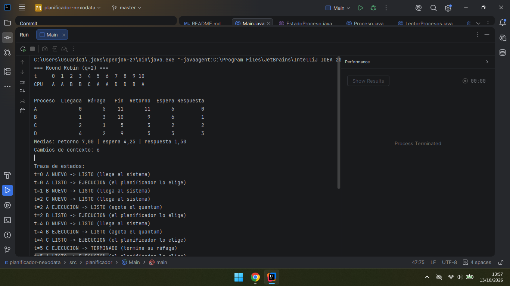

# Simulador de planificación · NexoData

> PSP · Tema 2 · Procesos · 2.º A DAM · **Jorge Moreno Rivero**

## 1. Qué hace

Es un programa de consola en Java que simula cómo un planificador de corto plazo reparte una sola CPU entre varios procesos. Lee los procesos de un fichero CSV (nombre, llegada y ráfaga) y los ejecuta con FCFS, SJF sin desalojo o Round Robin, según se le pida. Al terminar enseña el diagrama de Gantt, una tabla con fin, retorno, espera y respuesta de cada proceso con sus medias, los cambios de contexto y, si se pasa `--traza`, cada transición de estado con su motivo. Lo he usado para comparar los trabajos nocturnos de NexoData y recomendarles una política.

## 2. Cómo compilar y ejecutar

**Desde la terminal**, en la carpeta del proyecto:

```bash
javac -encoding UTF-8 -d out src/planificador/*.java
java -cp out planificador.Main datos/ejemplo_clase.csv rr 2 --traza
java -cp out planificador.Main datos/nocturno.csv todos 4
```

**Desde IntelliJ IDEA:** abrí la carpeta `planificador-nexodata` con *File → Open* y elegí una JDK (yo uso la 27; vale cualquiera desde la 17) en *File → Project Structure → Project*. Después creé una configuración de tipo *Application* en *Run → Edit Configurations*, con `planificador.Main` como clase principal. En *Program arguments* puse, por ejemplo, `datos/ejemplo_clase.csv rr 2 --traza`, y en *Working directory* la carpeta del proyecto. Si el directorio de trabajo está mal, el programa no encuentra los ficheros de `datos/`.



## 3. Diseño

Lo que más me preocupó fue no repetir el bucle de simulación tres veces, porque FCFS, SJF y Round Robin avanzan el tiempo, gestionan las llegadas y ejecutan igual. Solo se diferencian en a quién eligen y en cuándo le quitan la CPU. Por eso hice una clase abstracta, `Planificador`, que contiene el único bucle, y cada algoritmo es una subclase que sobrescribe dos métodos: `elegir()` y `agotaTurno()`.

- `EstadoProceso` es un enum con NUEVO, LISTO, EJECUCION, BLOQUEADO y TERMINADO.
- `Proceso` guarda nombre, llegada, ráfaga, tiempo restante, estado, primer instante en CPU y fin, y calcula retorno, espera y respuesta. Tiene un método `copia()` que devuelve el proceso sin simular. Lo uso para que cada algoritmo trabaje con sus propias copias y la opción `todos` no se encuentre los procesos ya terminados.
- `LectorProcesos` lee el CSV, ignora líneas vacías y comentarios, y lanza un mensaje claro si una línea está mal formada, la llegada es negativa o la ráfaga es 0 o menos.
- `Planificador` es el bucle común. En cada instante hace siempre lo mismo y en este orden: entran los que llegan, se mira si el proceso de la CPU ha terminado o agotado el quantum, si la CPU está libre se elige otro, y se ejecuta una unidad. Ese orden es el que hace que se cumplan las reglas 3 y 4 del enunciado, así que no conviene cambiarlo.
- `Fcfs` coge el primero de la cola. `Sjf` coge el de ráfaga más corta entre los ya llegados (empata por llegada y luego por orden en el fichero). `RoundRobin` coge el primero de la cola y agota el turno al llegar al quantum.
- `Resultado` agrupa lo que sale de una simulación, `Informe` lo imprime y `Simulador` une todo desde `Main`, que no he tocado salvo para llamar a `Simulador`.